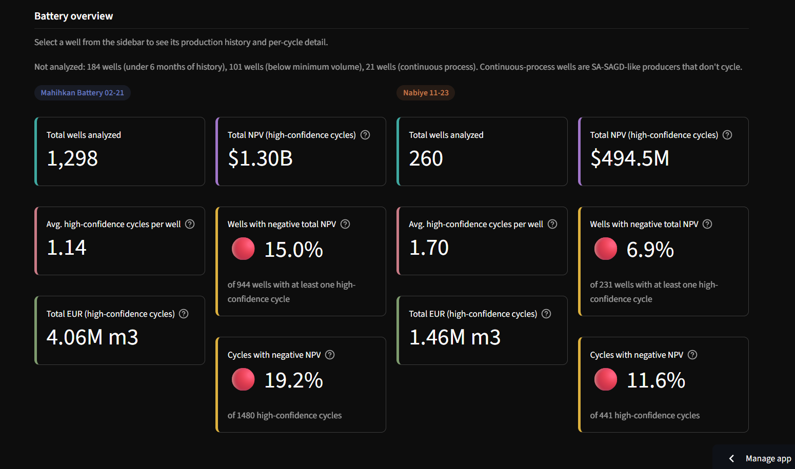
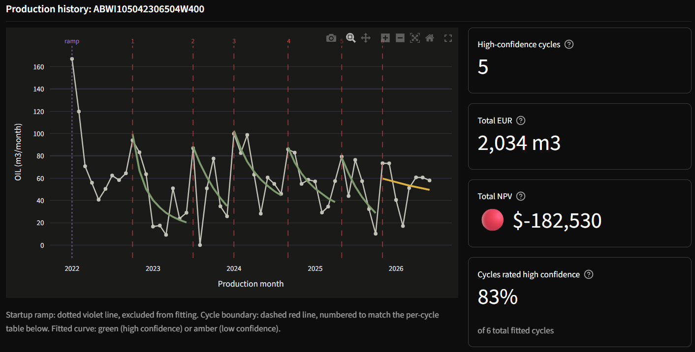
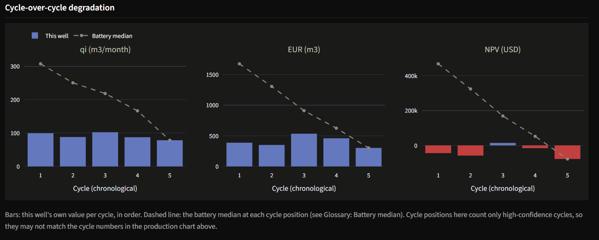
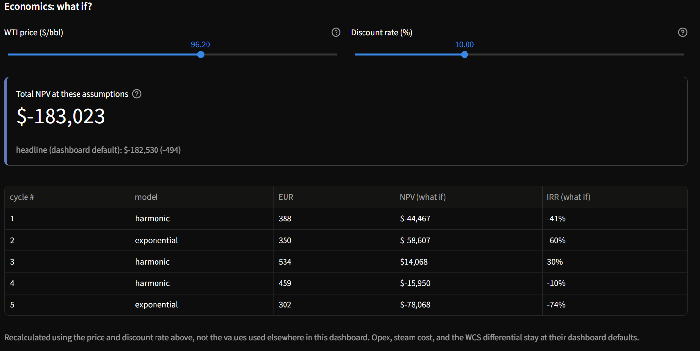

# Cold Lake CSS Decline Dashboard

Per-cycle Arps decline curve analysis and project economics for two Cold Lake CSS batteries, built on real Alberta production data (Petrinex). Live dashboard:
[cold-lake-petro-decline.streamlit.app](https://cold-lake-petro-decline.streamlit.app/)
Power BI Report: [petro-decline-curve.pbix](https://github.com/jasonou216/Petro-decline-curve/blob/main/powerbi/petro-decline-curve.pbix)

## Preview


*Landing view: per-battery metric cards (wells, avg. cycles, EUR, NPV, negative-NPV rate).*


*Raw monthly oil, cycle boundaries, and fitted Arps curve per cycle (green = high confidence, amber = low).*


*A well's qi/EUR/NPV across its own cycles vs. the battery median at the same cycle position.*


*Price and discount-rate sliders recompute NPV/IRR live for the selected well.*

## Why this isn't a standard decline curve project

Cold Lake bitumen is too thick to flow on its own (about 100,000 cP at 13 C), so operators use Cyclic Steam Stimulation (CSS): inject steam for 4-6 weeks, soak, produce until the rate falls off, re-steam, repeat. Imperial's filings with the AER put a well's life at 8-17 cycles over up to 50 years, with production periods stretching from a few months early on to years late in life. That rules out the usual decline-curve approaches:

1. **Well-level continuous decline** doesn't work: wells cycle in a sawtooth, not a smooth decline.
2. **Pad-level aggregation** doesn't work either. Mahihkan is a flat, managed plateau; Nabiye's apparent rise was new wells coming online, not existing wells improving.
3. **Per-cycle analysis** does: find each decline segment after a production peak per well, fit a decline curve to each on its own.

## Batteries analyzed

| Battery | Operator | Wells | HC cycles | Avg. HC cycles/well | EUR (m3) | NPV | Wells w/ negative NPV | Cycles w/ negative NPV |
|---|---|---|---|---|---|---|---|---|
| Mahihkan Battery 02-21 | Imperial Oil | 1,298 | 1,480 | 1.14 | 4,060,761 | $1,300,360,032 | 15.0% (of 944) | 19.2% |
| Nabiye 11-23 | Imperial Oil | 260 | 441 | 1.70 | 1,464,525 | $494,450,588 | 6.9% (of 231) | 11.6% |

Combined: 69.4% of fitted cycles are low confidence, 17.4% of high-confidence cycles are negative NPV, total modelled NPV $1,794,810,620 at WTI $96.24 (EIA, 6 Oct 2026), mean $934k and median $443k **per cycle**. **"Modelled NPV" is not an asset valuation**, see Key findings and Limitations. EUR is in m3 (Petrinex's unit). "Avg. HC cycles/well" is out of every analyzed well, including the half with zero or one.

Not analyzed: 21 continuous-process wells (see Methodology), 184 Mahihkan wells with under six months of history, and 101 wells that never top 50 m3/month. Battery volumes match the rates Imperial reported to the AER within 0-5% for 2023-24 (`notebooks/output/filings_validation.txt`).

## Theory

**Arps decline**: `q(t) = qi / (1 + b*Di*t)^(1/b)`, fit per cycle in three forms (exponential b=0, harmonic b=1, hyperbolic general form), on producing months only (shut-in and plant-outage months excluded). Winner picked **by AICc, not R2**: hyperbolic's extra parameter almost always wins on raw R2 regardless of merit; AICc corrects for that even at small sample sizes. Each form needs at least 2 residual degrees of freedom to be attempted.

**EUR**: `EUR = sum(t=0..T-1) q(t)`, where T is the cycle's observed duration, not an economic limit. Summed on the same monthly grid NPV uses, so the two are always consistent.

**NPV**: `NPV = sum(t) [q_t * (price - opex) / (1+r)^t] - steam_cost`. Price is WCS (WTI minus differential): a single day's live EIA spot quote held flat for the whole projection, not a forward strip, with a `config.yaml` fallback. Steam is paid two months before first production (injection plus soak, per the AER filings), so NPV and payback run from the spend.

## Methodology notes

- **Which wells**: each producer is profiled first (`wells.py`). Left out: wells with under 6 months of history, wells under 50 m3/month, and 21 Nabiye wells running 3,500-7,500 m3/month with no shut-in since mid-2024, which is how an SA-SAGD pad behaves, not a CSS well (SAGD produces continuously, no steam cycles). Sidetracks (well ID event suffix not 00) and wells that started inside the window are flagged, not excluded.
- **Cycle detection**: peak detection with relative/local prominence (a peak must clear its own preceding trough, not the well's all-time max), 4-month minimum spacing, startup ramp excluded. The 40% prominence threshold was checked, not assumed: 25 rejected near-miss candidates (30-40% band) judged by eye, ~60% were confirmed noise.
- **Plant outages**: a shutdown cuts every well at once and the recovery looks like a wave of re-steams (Nabiye had 67 cycle starts in Nov 2023 against a monthly median of 27 before masking). Months where a battery runs under 80% of its rolling baseline are interpolated for detection and dropped from fits. The detector finds Nabiye's documented Aug-Sep 2023 shutdown and the slow recovery after it.
- **Confidence flagging**: low confidence if the cycle is too short, R2 is poor, a parameter hits its bound, or too few producing months remain. About 69% are flagged, and the share barely moves when cycles are cut differently (see below), so it comes from the shape of the data: late-life production within a cycle often rises then falls, and Arps curves only decline. Excluded from EUR/NPV totals.
- **Shut-in months are excluded from fitting, not from EUR/NPV.** The curve fits producing months only, but still projects across the cycle's full duration, so a real mid-cycle interruption gets modeled revenue it didn't earn. Deliberate choice.

## Key findings

- **Recovery drops cycle-over-cycle.** From a well's 1st to its 2nd high-confidence cycle, qi falls in 71% of 588 wells and per-cycle recovery in 62% (Mahihkan 68% / 59%, Nabiye 77% / 70%). The direction held in all five detection settings tried (qi 61-86%, recovery 52-86%) and with sidetracks excluded (70% / 62%), but the size depends on how cycles are cut (`notebooks/output/sensitivity_report.txt`). Imperial's filings say the same thing for CSS in general: more steam each cycle to repressurize, wells communicating, more heat lost to the overburden.
- **"Cycle 1" is the first cycle in the data, not the first of the well's life.** Mahihkan has produced since 1985, so most cycles here are mid or late life. Only the 60 wells that started inside the window have lifetime numbers, and just 11 of them have a 1st-to-2nd transition (qi falls in 64%, recovery in 45%), too few to say anything. 587 of the 1,175 wells with a usable fit (50%) have exactly one high-confidence cycle, 87% of them Mahihkan.
- **SA-SAGD wells were driving the totals, and are now out.** In an earlier run those 21 wells were 7 of the 12 highest-NPV wells and a third of Nabiye's NPV. Imperial's 2025 filing says its first commercial SA-SAGD pad (S01, Grand Rapids) started producing at Nabiye in 2024, and the 21 wells' 2024 volume (662k m3) is within 13% of the 584k m3 reported for that pad. The filings list no well IDs, so the match is inferred from timing, rate and location. With them gone the top 10 wells are 8.4% of NPV.
- **NPV/EUR totals are a scale illustration, not the headline.** Real barrels under illustrative cost assumptions.
- **The negative-NPV share is mostly the steam-cost assumption.** It runs from 2% to 26% of cycles as the flat steam cost goes from $50k to $300k per cycle, and its rise with cycle position (14% to 20% at $200k) only appears at $200k and above. The filings' steam-oil ratios (Mahihkan about 4.5-5) put steam for the median cycle near 7,700 m3, so $200k is roughly $26 per m3 of steam, well above what I'd expect fuel alone to cost, so the base case is probably conservative. Treat it as a sensitivity, not a result.

## Limitations

- Petrinex's Files API 404s before 2022-01. The filings put first production at Mahihkan in 1985 and Nabiye in 2015, and older data may exist through other Petrinex/AER channels (their catalogue references data back to 2002), not pursued here.
- **A detected cycle is a decline segment after a production peak, not a confirmed steam job.** The median complete cycle is 8 months and 2% run 24 months or more, where the filings describe multi-year late-life cycles; only 13-24% of detected starts follow a zero-production month. Some of them are probably production humps or uplift from nearby infill wells being steamed. Cutting cycles differently (12-month spacing, or requiring a steam gap) didn't change the main finding and didn't improve the share of trusted fits (31-34% with wider spacing, 17-23% with a steam-gap rule), so I couldn't find a cut that's clearly better. Resolving it needs real steam dates.
- **Not modelled:** LASER diluent co-injection (about 19 Mahihkan pads per the filings, which Imperial says can add more than 5% of effective bitumen in place on late cycles) and infill wells. There's no well-to-pad mapping to flag them. LASER should lift later cycles, which would hide part of the decline rather than create it.
- **Sidetracks** (46 wells, 3%) have a first-cycle EUR about 2.7x other wells'. Flagged, left in; excluding them doesn't change the main finding.
- **Reporting change at Mahihkan:** 184 wells first appear in May 2026, the month the battery's well count jumps by about 190 and its rate by 16%. It looks like a facility change rather than drilling (the filings report a handful of drilled or redrilled wells a year), but I can't confirm it from the data.
- **Outage detection is data-driven.** The 2022-operating-year filing wasn't available, so only Nabiye's 2023 shutdown is corroborated; it also flags Nabiye in May 2026 and Mahihkan in Feb 2022.
- Revenue is priced at the WCS blended rate against raw bitumen volume with only a flat differential; a real bitumen netback nets out diluent (condensate, ~25-30% of WCS) separately, so netback here is optimistic.
- **No Crown royalty or abandonment/reclamation liability.** Alberta oil sands royalty is ~1-9% of gross pre-payout, 25-40% of net post-payout. Not modeled at all, materially overstates every NPV figure.
- Economics are per cycle. Imperial abandons pads at "end of economic viability" (28-62% of effective bitumen in place recovered) but keeps steaming most pads, while this model scores 17% of cycles negative, so shared pad-level costs and the flat steam cost matter more than the sign of any one cycle.
- All monetary figures are USD. Alberta opex is normally quoted CAD; no conversion applied. The 10% discount rate is nominal but applied to flat, non-escalating cash flows, which understates true NPV.
- The R2 >= 0.5 "high confidence" threshold is a starting guess, not validated. Tightening to 0.7 keeps 69% of cycles and 70% of NPV, so the totals don't lean on the low-R2 band.
- The two batteries are a hardcoded constant (`TARGET_BATTERIES` in `data.py`), not a runtime parameter. Built for CSS thermal specifically, wouldn't hold for conventional or SAGD without adaptation.
- IRR can hit meaningless thousands-of-percent values for a tiny/front-loaded cost basis; NPV is the reliable number. IRR is also undefined (not a bug) when a cash flow never goes negative, shown as "n/a (never negative)".
- Production is the instantaneous monthly rate (no mid-month convention). Curve fitting is unweighted, so early high-rate months dominate more than the tail, which is what EUR and late-cycle economics hinge on.

## Sources

Imperial Oil, Cold Lake Operations, Directive 054 Annual Submission to the AER (approval 8558): 2021 operating year (June 2022), 2023 (June 2024), 2024 (June 2025). Used for cycle and steam timing, plant bitumen rates, and the SA-SAGD, LASER, infill and outage context above. The 2022-operating-year submission wasn't available.

## Files

- [`app.py`](app.py): Streamlit dashboard (7 panels, 2 tabs)
- [`src/petro_decline/data.py`](src/petro_decline/data.py): Petrinex pull, filtering, injector ID
- [`src/petro_decline/wells.py`](src/petro_decline/wells.py): per-well profile, eligibility and sidetrack/new-well flags
- [`src/petro_decline/outages.py`](src/petro_decline/outages.py): plant-outage months
- [`src/petro_decline/cycles.py`](src/petro_decline/cycles.py): cycle detection
- [`src/petro_decline/decline.py`](src/petro_decline/decline.py): Arps fitting, model selection
- [`src/petro_decline/eur.py`](src/petro_decline/eur.py): EUR
- [`src/petro_decline/economics.py`](src/petro_decline/economics.py): NPV, IRR, live WTI
- [`config.yaml`](config.yaml): sourced economic assumptions
- [`tests/`](tests/): unit tests, one file per `src/petro_decline/` module
- [`notebooks/detect_cycles_full.py`](notebooks/detect_cycles_full.py): full-scale cycle detection (feeds `decline.py`)
- [`notebooks/sensitivity_checks.py`](notebooks/sensitivity_checks.py): reruns detection under other settings, splits the main finding by well group
- [`notebooks/validate_against_filings.py`](notebooks/validate_against_filings.py): Petrinex volumes vs. Imperial's AER-reported rates
- `data/processed/`, `notebooks/output/`: pipeline outputs, committed so the dashboard runs without re-pulling data
- [`src/petro_decline/bi_export.py`](src/petro_decline/bi_export.py): star-schema CSV export (`bi_exports/`) for the Power BI companion report below

## Architecture

Pipeline diagram (data sources through to both the dashboard and the Power BI export) is in [`docs/architecture.md`](docs/architecture.md).

## Power BI companion report

A second, separate look at the same data: [`powerbi/petro-decline-curve.pbix`](powerbi/petro-decline-curve.pbix), built in Power BI Desktop against the star schema in `bi_exports/` (`dim_battery`, `dim_well`, `fact_cycle`). DAX measure definitions are in [`docs/power_bi_measures.md`](docs/power_bi_measures.md). Requires Power BI Desktop (free, Windows) to open.

## How to run

```bash
git clone https://github.com/jasonou216/Petro-decline-curve.git
cd Petro-decline-curve
python -m venv .venv
.venv\Scripts\activate       # Windows
source .venv/bin/activate    # Mac/Linux
pip install -r requirements.txt
# add a .env file with EIA_API_KEY=your-key-here (free at eia.gov/opendata)
# without it, the dashboard falls back to config.yaml's dated price
streamlit run app.py
```

## Tools

Python, pandas, numpy, scipy, Streamlit, Plotly, PyYAML, python-dotenv, Petrinex public API, EIA public API.

## Data license

Petrinex data is Government of Alberta Crown copyright, acknowledged here. Used for non-commercial purposes per [Petrinex's terms of use](https://www.petrinex.ca/terms), which permit that without separate consent.

## Skills demonstrated

Time-series analysis • signal processing (peak detection) • nonlinear curve fitting • statistical model selection (AICc) • financial modeling (NPV, IRR, sensitivity analysis) • API integration • data pipeline design • interactive dashboard development • unit testing • domain-specific problem framing (petroleum engineering)

## How this was built

Claude (Anthropic) was used throughout as a coding assistant, implementation, debugging, and structured code review (see `KNOWN_ISSUES.md`). Every methodology call was mine: per-cycle vs. pad-level fitting, AIC-then-AICc model selection, what EUR/NPV should and shouldn't claim, which cost assumptions to flag as illustrative rather than real. Each was checked against the raw data before I accepted it.
