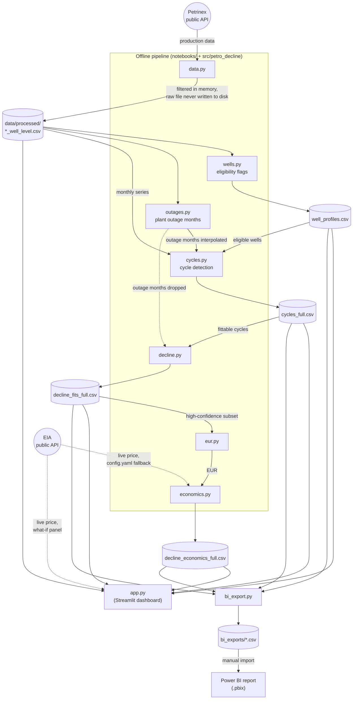

# Architecture

`app.py` reads the committed CSVs for its headline numbers, but also calls `decline.py` and `economics.py` directly at runtime (redrawing fitted curves, live what-if repricing), it isn't purely a static-file reader. `bi_export.py` only ever reads already-computed CSVs, it has no API or pricing dependency of its own.

`wells.py` decides which producers enter the analysis (continuous-process wells, wells with under six months of history and tiny wells are left out) and flags sidetracks and wells that started inside the data window. `outages.py` finds months where a whole battery dropped well below its own baseline, so a plant shutdown isn't read as a wave of re-steams.
